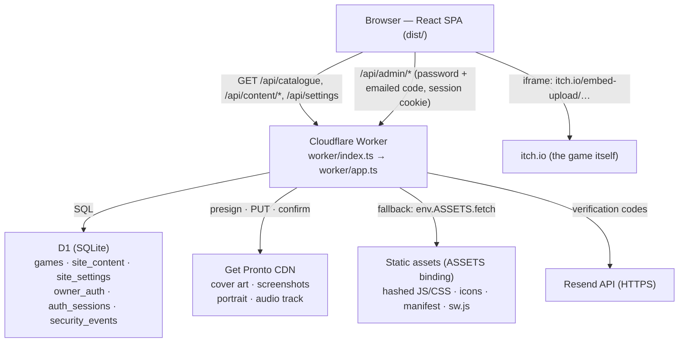

# Hemang Gupta — indie game arcade

A personal site for an independent game developer: an editorial portfolio plus a
real browser-game arcade. Visitors browse a catalogue that comes from a database,
filter and search it, and play each game through its **itch.io HTML5 embed**
inside the page — including fullscreen. The owner publishes and edits everything
through a private dashboard; no content ships in the bundle and nothing needs a
rebuild or redeploy.

```
PUBLIC SITE                         OWNER DASHBOARD (/admin, sign-in + emailed code)
───────────────────────────────     ──────────────────────────────────────────────
/            hero + featured         games      connect itch.io → preview → publish
/games       catalogue + filters     player     page URL, embed URL, live preview
/games/<slug> detail page + player   artwork    thumbnail, banner, screenshots
/about       content from the DB     content    edit + publish the About/Contact pages
/contact     public address only     site       appearance settings
/privacy     what is stored locally  account    password, authentication address, sessions
```

Two rules shape the design and the code:

1. **Content is data.** Games, artwork, cover images and page copy live in the
   database and object store, not in source files. A fresh clone starts with an
   empty arcade and a first-run setup screen. The games themselves are hosted on
   itch.io and framed on the game page.
2. **Two addresses, never one.** A *private* authentication address receives
   sign-in codes; a *public* contact address is what visitors see. The server
   refuses to publish one as the other.

## Honest status

| Level | Meaning |
| --- | --- |
| ✅ **Verified** | Implemented, and exercised by the automated run in [§7](#7-preview-production-build-and-automated-checks). |
| 🟡 **Implemented, not proven end-to-end** | The code path exists and is unit tested, but the real-world half needs an account you own. |
| ⚙️ **Needs external setup** | Correct code, missing credentials/configuration. |
| ⬜ **Not implemented** | Explicitly absent — do not assume it works. |

- ✅ The public site, catalogue, search/filters/sorting, player, fullscreen, mobile
  layout, owner gate, dashboard, uploads, publication states, About editor and
  appearance settings all run against the real Worker locally.
- 🟡 **Real email delivery.** The verification flow is proven end to end through a
  loopback email catcher; the Resend request itself is unit tested with a stubbed
  `fetch`. No real message has been sent from this machine.
- 🟡 **Owner credentials.** Sign-in is the site's own: a login address, a PBKDF2
  password hash and a six-digit code emailed to a separately configured address.
  No third-party identity provider is involved. Provisioning needs
  `OWNER_LOGIN_EMAIL`, `OWNER_OTP_EMAIL` and a one-time `OWNER_SETUP_TOKEN`; until
  a password exists, `/admin` shows the setup screen and reports what is missing.
- ⚙️ **Production hosting.** No deployment exists yet (verified: the hosting
  tooling reports no site for this workspace). [§11](#11-production-hosting-and-deployment)
  documents the two supported paths and what is still missing.
- ⬜ **Public password reset.** Deliberately absent; see [§9](#9-authentication-and-administration).
- ⬜ **Offline gameplay.** The service worker caches the app shell only; games
  come from itch.io and are never cached.

## 1. Technology stack

Everything below was taken from `package.json`, `node_modules/*/package.json`,
`wrangler.jsonc`, `vite.config.ts`, the two `tsconfig` files and the migrations —
not from a template. Installed versions were read from this checkout.

| Concern | What is actually used | Version (installed) |
| --- | --- | --- |
| UI library | React + React DOM | 19.3.1 |
| Language | TypeScript, `strict`, in both the app and the Worker | 6.0.3 |
| Routing | `react-router-dom` (`BrowserRouter`, lazy route chunks) | 7.18.4 |
| Styling | Hand-written CSS with custom properties — seven global stylesheets (`boot` is the opening card), no CSS framework, no CSS-in-JS | files in `src/styles/` |
| Fonts | Self-hosted variable fonts via Fontsource: Syne (display headlines, game titles), Fraunces (the multilingual greeting and serif phrases), Space Grotesk (sub-heads, navigation, labels) and Inter (body copy, forms, metadata) | 5.3.0 each |
| Build tool | Vite, target `es2022` | 8.3.4 |
| React plugin | `@vitejs/plugin-react` | 6.1.2 |
| Worker bundler | esbuild, invoked by `scripts/build-worker.mjs` | 0.28.2 |
| Runtime (backend) | Cloudflare Workers (`workerd`); `compatibility_date` `2026-10-01`, flag `nodejs_compat` | wrangler 4.151.0 |
| Database | Cloudflare D1 (SQLite); schema in `migrations/` | via `DB` binding |
| Image and audio storage | Get Pronto REST API (presign → upload → confirm), called with `fetch`; no SDK dependency | free plan: 5 GB storage, 10 GB/month, 10 MB per file |
| Static assets | Vite output in `dist/`, served by the Worker through the `ASSETS` binding | — |
| Authentication | The app's own: login address + password (PBKDF2-SHA256, 100 000 iterations) + a six-digit emailed code, D1-backed sessions in a signed cookie — no third-party identity provider | — |
| Transactional email | Resend REST API called with `fetch` (no SDK dependency), plus a loopback catcher for local development | — |
| Unit tests | Vitest (`node` environment) | 5.0.5 |
| Browser checks | `playwright-core` driving an installed Chromium-family browser | 1.64.1 |
| Linting | ESLint flat config + `typescript-eslint` + `eslint-plugin-react-hooks` | 10.12.0 / 8.71.2 / 7.1.1 |
| Package manager | npm, lockfile version 3 (`package-lock.json` is the source of truth) | npm 12.0.1 |

**Not present**, despite being common in similar projects: Next.js, any SSR
framework, a Node/Express server, Supabase/PostgreSQL, Prisma or another ORM, a
CSS framework (Tailwind/Bootstrap), a component library, a state-management
library (Redux/Zustand — React context + `useReducer` instead), an analytics
package, and any runtime dependency on a CDN.

## 2. Architecture

One deployable unit. `worker/index.ts` builds the handler and hands every request
to `worker/app.ts` — there is no external auth middleware, so nothing is answered
outside the app's own authorization code. `worker/app.ts` routes, in this order:
`/api/health`, the public catalogue and media API
(`/api/catalogue`, `/api/catalogue/<slug>`, `/api/media/artwork|screenshot/*`),
`/api/settings`, `/api/content/about|contact|social`, `/api/music`,
`/api/media/content/avatar`, `/sitemap.xml`, the owner API under `/api/admin/**`,
a JSON 404 for any other `/api/*` path, and finally the static build from `dist/`
through the `ASSETS` binding.



### Public pages

The SPA fetches `GET /api/catalogue` once per load (a context provider) and
`GET /api/content/about|contact|social` and `/api/settings` for the editable copy
and appearance. Those responses are `public, max-age=0, must-revalidate` with a weak
`ETag`, so a repeat load costs a 304, and the client revalidates on window focus
after a minute — publishing in the dashboard is visible to an open tab without a
rebuild.

Game pages are rendered client-side from `/api/catalogue/<slug>`; the server is the
only authority on what is public: drafts and archived games are absent from the
public response and answer 404, and `sitemap.xml` lists published games only.

### Owner authentication and authorisation

Two stages, both enforced on the server:

1. **Identity** — `POST /api/admin/auth/login` compares the typed address with the
   configured login address and the password with the PBKDF2 hash in `owner_auth`.
   There is no registration route: the password is written exactly once by the
   owner, through `POST /api/admin/auth/setup` with `OWNER_SETUP_TOKEN`, and that
   route refuses with `409 already_setup` as soon as a password exists.
2. **Access** — a correct password sends a six-digit code to the separately
   configured delivery address. Accepting it (`POST /api/admin/auth/verify`) is
   what writes a row in `auth_sessions`, good for 12 hours. A correct password with
   no code leaves every `/api/admin/*` call at `401 verification_required`.

Every admin request re-checks the session row, and mutating requests must come
from the site's own origin (`isSameOriginRequest`). Details in
[docs/SECURITY.md](docs/SECURITY.md).

### artwork, the itch.io player and isolation

- **The game is not hosted here.** Each listing stores two itch.io addresses:
  the public project page (`https://<creator>.itch.io/<game>`) and the playable
  iframe address itch generates under *Edit game → Embed* (`https://itch.io/embed-upload/<id>`).
  Both are parsed by `src/shared/itch.ts` in the dashboard *and* the Worker; only
  `https:` on the exact itch.io hosts is accepted, and the store widget
  (`itch.io/embed/…`) is refused because it cannot be played.
- **The embed id cannot be derived from the project URL.** It identifies the
  uploaded HTML5 file, so the dashboard asks for both and explains where the
  second one comes from. A listing cannot be published until both are saved.
- **Cover art and screenshots stay on your own storage.** Images are identified
  by magic bytes (PNG, JPEG, WebP, GIF, AVIF), capped at 8 MB each (inside Get
  Pronto's 10 MB free-plan ceiling), uploaded by the Worker with a secret key and
  served from the media CDN. A row written before the move keeps its
  `/api/media/artwork|screenshot/*` address, which now redirects. Nothing is
  fetched from itch.io automatically.
- **The player is a cross-origin frame.** It uses `https://itch.io/embed-upload/…`
  with `allow="fullscreen; gamepad; autoplay"` and a sandbox that grants a game
  its own scripts, storage, pointer lock and popups. The itch.io origin boundary
  is the isolation: the frame cannot read this site's DOM, cookies or admin
  session. The player never claims more than it can know — a cross-origin frame
  reports `load` even for an error page, so the direct itch.io link is always on
  screen and the timeout explains a stalled embed.
- **The local build workflow is gone.** The ZIP uploader, the `builds` API and
  the `/play/**` routes were removed once every listing played from itch.io. The
  `builds` and `build_files` tables stay in D1 — dropping them would delete data
  for no gain — but nothing reads or writes them.
- Deploying the frontend alone is not enough: without `DB` there is no
  catalogue, and without `GETPRONTO_API_KEY` the dashboard cannot store an image.

### The About/Contact/Social editor

`site_content` holds a `draft` and a `published` JSON document per key (`about`,
`contact`, `social`). Saving writes the draft; **Publish** copies draft → published
and the public endpoint serves only `published`. Visitors can never read a draft,
and the preview endpoint requires the owner. Appearance settings (`site_settings`)
are small and live: they apply immediately.

The `social` document is the one source of truth for the band at the bottom of
every public page, edited at **/admin/social**. Each entry carries a platform, a
label, a URL, an optional handle and note, and an enabled flag; **the order of the
array is the display order**, so the move buttons are the only position control
and there is nothing that can drift out of sync with it. URLs are normalised and
checked  in `src/shared/site-content.ts` and again on the Worker (`validateSocial`):
a pasted bare domain gains `https://`, fragments are dropped, and every scheme that
is not `https` (or `mailto:` for the email platform) is refused rather than cleaned
up, so `javascript:` and `data:` never reach an `href`. Saving, publishing, discarding, reordering and
deleting all go through the authenticated admin API, and a disabled link leaves
the public page on the next load — no rebuild, no redeploy.

### Email, and the three addresses

`worker/lib/email.ts` chooses a provider at request time and reports its state
honestly: `resend` when a key and sender exist, a loopback catcher only when both
the request and `APP_ORIGIN` are loopback, otherwise a `503 email_unconfigured`
(no invented codes, ever).

The owner has three addresses and the server keeps them apart: the **login
address** (`owner_auth.login_email`, what is typed at sign-in), the **code
delivery address** (`owner_auth.auth_email`, where OTPs go, optionally pinned by
`OWNER_OTP_EMAIL`) and the **public contact address** (a field of the `contact`
content document, the only one rendered publicly). Both private addresses are
masked in every admin response, never appear in a public payload, and are refused
as a public contact value (`422 email_conflict`).

## 3. Prerequisites

**Local development (all verified on this machine):**

- **Node.js ≥ 22.13** or a 24.x release. The project declares no `engines` field,
  but its installed tools do: Vite requires `^20.19 || >=22.12`, Vitest `^22.12 ||
  ^24 || >=26`, ESLint `^20.19 || ^22.13 || >=24`, Wrangler `>=22`. Verified with
  **Node 24.18.0** and **npm 12.0.1**.
- **npm** (comes with Node). The lockfile is version 3; use `npm ci` for a
  reproducible install.
- The verified runtime is pinned in [`.nvmrc`](.nvmrc) (`24.18.0`), and the
  repository includes a [`Dockerfile`](Dockerfile) for a clean Worker preview.
- **A Chromium-family browser** for the end-to-end suite only. `playwright-core`
  ships the driver, not a browser; the default `BROWSER_PATH` in
  `scripts/verify.mjs` and `scripts/seed-dev.mjs`-adjacent scripts is Brave on
  Windows — override it with `BROWSER_PATH=/path/to/chrome`.
- No local database server is required: `wrangler dev` emulates D1 and a local
  file bucket in `.wrangler/state` (gitignored, disposable). Docker is optional;
  the included image runs the same local Worker preview on port `8787`.

**Production / owner features:**

- A **Cloudflare account** (Workers, D1) — or the Freebuff Sites tooling, see
  [§11](#11-production-hosting-and-deployment). No R2 bucket is needed.
- A **Get Pronto account** (free) with a secret API key, set as
  `GETPRONTO_API_KEY`. Without it the site runs, but every upload is refused with
  `503 unconfigured`.
- **No external identity provider.** The owner's credentials live in this site's
  own database; there is no third-party sign-in to configure.
- An **administrator login address**, a **code delivery address** (they may differ)
  and a one-time **`OWNER_SETUP_TOKEN`** — see [§9](#9-authentication-and-administration).
- A **Resend account** with a verified sending domain, for real verification email
  (free tier: 3 000 messages/month, 100/day).
- A **domain** you control, at any registrar — see
  [§12](#12-custom-domain-setup).

## 4. Project structure

```
worker/
  index.ts            Worker entry: createApp() → routing → static assets
  app.ts              the API: catalogue, content, media, admin, sitemap
  lib/media-store.ts  uploads to Get Pronto (or the local bucket) and deletes by reference
  lib/                db (queries) · owner (identity) · owner-security (2nd factor, sessions)
                      email (provider selection + templates) · crypto · content (defaults/validation)
src/
  shared/             types + rules used by BOTH Worker and UI
                      catalogue · site-content · owner-security · build-files · music
  data/site.ts        public branding/config (name, domain, nav, feature toggles;
                      social links live in the database, not here)
  lib/                api client, catalogue + content contexts, search/sort, storage, hooks, zip worker
  components/         layout, nav, search overlay, cards, player, decorations, editors,
                      SocialSection (the public social band, shared with its preview),
                      BootScreen (the opening card) + TypewriterHeadline (the hero headline)
  pages/              home, games, game detail, about, contact, privacy, 404, admin/*
  styles/             tokens · base · layout · components · pages · boot · admin
public/               favicon + app icons, /art/fallback.svg, manifest, sw.js, offline.html, robots.txt
migrations/           0001_init.sql · 0002_content_and_owner_auth.sql
                      0003_owner_login_identity.sql
scripts/              build-worker.mjs · seed-dev.mjs · verify.mjs · audit-design.mjs
                      audit-security.mjs · generate-icons.mjs
                      lib/ (zip writer, cover-art generator, disposable test build)
tests/                Vitest suites (10 files, 183 tests)
docs/                 ADDING-A-GAME.md · SECURITY.md · DEPLOYMENT.md · VERIFICATION.md
                      AUDIT.md (findings, fixes and the commands that prove them)
wrangler.jsonc        Worker entry, bindings, non-secret vars, limits
vite.config.ts        frontend build + dev proxy (/api, /play, /auth → :8787)
tsconfig.json         app (DOM) · worker/tsconfig.json (Workers types)
.nvmrc                 pinned Node runtime (24.18.0)
Dockerfile            reproducible local Worker image
Makefile              offline `make test` / `make build` shortcuts
.dev.vars.example     template for the gitignored `.dev.vars`
```

Generated and machine-local, excluded from the tree above: `node_modules/`,
`dist/`, `dist-worker/`, `.wrangler/`, `verification/`.

## 5. Environment variables and secrets

Names below are exactly those read by `worker/app.ts` (the `Env` interface) — do not
rename them.

| Variable | Purpose | Required | Where the value comes from | Local | Production |
| --- | --- | --- | --- | --- | --- |
| `DB` | D1 binding (games, content, auth) | yes | `wrangler.jsonc` | emulated by `wrangler dev` | created by hosting / `wrangler d1 create` |
| `GETPRONTO_API_KEY` | Secret key (`pronto_sk_…`) for cover art, screenshots, the portrait and the audio track | yes for uploads | Get Pronto dashboard → API keys | optional; omitted ⇒ local bucket | Worker secret |
| `FILES` | Optional object bucket. Only used when `GETPRONTO_API_KEY` is absent (local development, or a deployment that still has a bucket) | no | `wrangler.jsonc` | emulated | not needed |
| `ASSETS` | Static build binding | yes | `wrangler.jsonc` | served from `dist/` | uploaded build output |
| `APP_ORIGIN` | The site's own origin; used for OIDC callbacks, cookie scope, origin checks and the local-seam guard | yes in production | hosting platform injects it; locally `.dev.vars` | `.dev.vars` (`http://127.0.0.1:8787`) | injected |
| `OWNER_LOGIN_EMAIL` | **Private** administrator login address (what is typed at sign-in) | yes for `/admin` | you; Worker secret | `.dev.vars` | secret |
| `OWNER_OTP_EMAIL` | **Private** code delivery address (may differ from the login address) | optional | you; Worker secret | `.dev.vars` | secret |
| `OWNER_SETUP_TOKEN` | One-time token for first-run provisioning; remove once a password exists | once | you; Worker secret | `.dev.vars` | secret |
| `OWNER_SUB` | Stable key for the single owner row (default `owner`) | optional | you | `.dev.vars` | var |
| `OWNER_AUTH_EMAIL` / `OWNER_EMAIL` | Legacy names for the code delivery address, still honoured as a fallback | optional | you | `.dev.vars` | secret |
| `RESEND_API_KEY` | Send verification codes | for real email | Resend dashboard | optional | secret |
| `EMAIL_FROM` | Verified sender, e.g. `Arcade <verify@your-domain>` | with the key | your verified domain | optional | secret |
| `EMAIL_PROVIDER` | `auto` (default) · `resend` · `local` · `none` | optional | — | `local` for the catcher | `resend` or unset |
| `EMAIL_REPLY_TO` | Reply-To on verification mail | optional | you | — | secret/var |
| `EMAIL_APP_NAME` | Name used in the email subject/body | optional | `wrangler.jsonc` `vars` | from config | from config |
| `DEV_OWNER_SUB` | Development owner seam (identity for `x-dev-owner`) | local only | you | `.dev.vars` | **must not be set** |
| `DEV_OWNER_EMAIL` | Fallback authentication address for seed/verify | local only | you | `.dev.vars` | **must not be set** |
| `DEV_OWNER_PASSWORD` | Password used by the seed script | local only | you | `.dev.vars` | **must not be set** |

**Frontend exposure.** Only `/api/*` JSON is sent to the browser. No variable in
the table above is inlined into the bundle — the app reads configuration from the
API, and `import.meta.env` is used solely for `BASE_URL`/`PROD`. Everything marked
*secret* must stay server-side: `OWNER_LOGIN_EMAIL`, `OWNER_OTP_EMAIL`,
`OWNER_SETUP_TOKEN`, `RESEND_API_KEY`, `EMAIL_FROM`, `EMAIL_REPLY_TO`, and the
`DEV_OWNER_*` trio.

**Template.** [`.dev.vars.example`](.dev.vars.example) contains placeholders only:

```bash
cp .dev.vars.example .dev.vars   # then replace every placeholder
```

`.dev.vars` is gitignored (the template is explicitly un-ignored). Never commit it,
and never put these values in `wrangler.jsonc` `vars`.

For the two addresses specifically — the private authentication inbox and the
public contact address, where each one is set locally and in production, and how
to verify delivery without ever seeing a code — see
[**SETUP_EMAILS.md**](SETUP_EMAILS.md).

## 6. Install and run locally

```bash
# 1. dependencies (reproducible install from the lockfile)
npm ci

# 2. local variables — placeholders only, then edit them
cp .dev.vars.example .dev.vars
```

Then start the application, which is one process for API, auth, media and assets:

```bash
# terminal 1 — the whole application on http://127.0.0.1:8787
npm run dev:full

# terminal 2 — first run only: create the local D1 schema
npm run db:migrate

# terminal 2 — optional: unpublished admin fixtures (no public games)
npm run seed
```

Open **<http://127.0.0.1:8787>**.

- `npm run dev:full` is `wrangler dev`: it emulates D1 and a local file store
  under `.wrangler/state`, so no database server or storage account is required —
  and it starts whether or not the schema exists yet.
- `npm run db:migrate` (`wrangler d1 migrations apply DB --local`) only applies new
  files and prints `No migrations to apply!` once the schema is current.
- `npm run seed` installs fixtures **through the running admin API**, so it needs
  the server from terminal 1, plus `DEV_OWNER_SUB`, `DEV_OWNER_EMAIL` and
  `DEV_OWNER_PASSWORD` in `.dev.vars`. It refuses to run against a non-loopback
  `API_ORIGIN`.
- `/admin` opens the first-run setup screen until you complete owner security
  (login address + password + `OWNER_SETUP_TOKEN`), and the sign-in gate
  afterwards.
- Stop the server with `Ctrl+C` in its terminal (or close the background process).

### Frontend-only mode (limited)

```bash
npm run dev:full   # terminal 1 — API, D1, local file store, auth
npm run dev       # terminal 2 — Vite + HMR on http://localhost:5173
```

`npm run dev` proxies `/api` to `http://localhost:8787`
(`vite.config.ts`), so with both running you get hot reload **and** a working
backend. With Vite alone the app shell renders but the catalogue, player and admin
calls fail — it is not a usable preview of the product.

Password/verification email never leaves your machine in local mode:
`EMAIL_PROVIDER=local` uses the loopback catcher, which is refused when either the
request or `APP_ORIGIN` is not loopback.

## 7. Preview, production build and automated checks

| Command | What it actually does |
| --- | --- |
| `npm run dev:full` | Local application (Worker + D1 + local file store) on `127.0.0.1:8787`. This is the closest local equivalent of production. |
| `npm run dev` | Vite dev server with HMR on `:5173`, API proxied to `:8787`. |
| `npm run build` | `vite build` → `dist/` (hashed assets, icons, manifest, `sw.js`, `robots.txt`). **Does not type-check.** |
| `npm run build:worker` | Bundles `worker/index.ts` with esbuild → `dist-worker/index.js` (single ESM file, dependencies inlined). |
| `npm run build:all` | `typecheck` → `vite build` → `build:worker`. Use this before deploying. |
| `npm run preview` | `vite preview` on `:4173`. Static output only — no Worker, so `/api` 404s. Useful for checking CSS/JS output, not the app. |
| `npm run typecheck` | `tsc --noEmit` for the app **and** `tsc -p worker --noEmit`. |
| `npm run lint` | ESLint flat config. |
| `npm test` | Vitest unit/policy suite (183 tests in 10 files). `npm run test:watch` for the watch loop. |
| `npm run verify` | ✅ **389/389** checks pass end to end: empty state, the first-load card, the bouncing decoration field (ten marks by default, travel on both axes, distinct speeds, a measured turn-around at both the horizontal and vertical edges, viewport bounds after a resize, no overflow, click-through, still under reduced motion), the ambient music control and volume slider (silent and unfetched until asked, one looping element, real volume changes, mute/unmute preserving the level, the level surviving a reload, no duplicate across routes, honest failure), the dashboard music editor (upload to R2, public configuration, byte ranges, replace, disable, remove, refused uploads, anonymous refusal, bundled track restored), catalogue + ETag revalidation, a temporary published game with an itch.io player (URL validation, storage, preview without publishing, cover art + screenshots, publish gate, iframe source/sandbox/allow, click/keyboard input, fullscreen, resize without reload, stalled-embed fallback, edit without redeploy, unpublish, delete), the header at 360/390/430/768/1024/1440 px, owner sign-in with emailed code, site content, social links, responsive widths, the theme control (geometry, fill, system default, neutral public and dashboard surfaces, dashboard persistence), and the performance bounds |
| `npm run audit:security` | Server-side authorization audit: calls every admin route with no session, with a tampered session cookie and with an unverified password-only session, and asserts a refusal plus no mutation. **Run it on its own** — it and the browser suite share the same local security state, so overlapping runs invalidate each other. |
| `npm run audit:design` | Design audit + screenshots (`verification/design/`): heavy frames and hard shadows, section numerals, the restrained texture set, the three type tiers, press/hover behaviour, player framing, the opening sequence, AA contrast in both paper palettes, and no overflow at 7 widths. Read-only and screenshots public pages; the detailed card/player checks need at least one published game, so on an empty arcade it completes the screenshot pass and stops. |
| `npm run db:migrate` / `:remote` | Apply migrations to local / deployed D1. |
| `npm run seed` | Development fixtures via the real admin API. |
| `npm run icons` | Regenerate the PNG app icons from `scripts/generate-icons.mjs`. |

### The browser suite

```bash
npm run dev:full        # terminal 1
npm run seed            # terminal 2, once
npm run verify          # terminal 2
# non-default browser location:
BROWSER_PATH="/path/to/chrome" npm run verify
```

It drives the real Worker in a real browser: catalogue/search/filters, detail
pages, the sandboxed player (input reaches the build, fullscreen is a real
Fullscreen API call, a refused build shows an error state), uploads, publication
states, owner sign-in with emailed codes, the About editor, the social links
manager (add, edit, reorder, disable, delete, preview, publish) and the public
band it produces, appearance settings, and the responsive sweep. Screenshots land
in `verification/`.

It starts by putting the local database back to a known baseline through two
loopback-only routes (`/api/admin/dev/security-reset`, which clears the sticky
rate-limit state, and `/api/admin/dev/content-reset`, which restores the shipped
About/Contact/Social documents), so a run that crashed before its own cleanup
cannot fail the next one. Neither route exists behind a deployed origin.

### The security audit

```bash
npm run dev:full        # terminal 1
npm run audit:security  # terminal 2 — on its own, not beside other suites
```

Every protected admin route is called without a session, with a forged session
cookie, and with a session that has a password but no second factor; each call
must be refused **and** must leave the database unchanged (the audit re-reads the
rows it targeted). It also covers the login/OTP policy end to end: wrong
password, right password with no code, wrong code, expired code, a replayed code,
a superseded code, the attempt and resend limits, a refused email provider, and
sign-out. None of it uses a backdoor — it drives the same endpoints the browser
does, with the loopback development seam for the session half.

### The design audit

```bash
npm run dev:full        # terminal 1
npm run audit:design    # terminal 2
BASE_URL=https://your.domain npm run audit:design   # public pages only; no owner session
```

It reads computed styles rather than source: heavy frames and `--gouge` shadows,
crop marks, outline section numerals, per-section textures and colour schemes,
the three type tiers, press/hover behaviour, the player's inline and fullscreen
framing, the opening sequence and the typed headline, AA contrast in **both**
themes, and horizontal overflow on 6 routes × 7 widths. Screenshots go to
`verification/design/`. See [§16](#16-design-system).

### The opening sequence, the typed headline and the reveal pass

A first full page load opens on a full-screen title card (`src/components/BootScreen.tsx`,
`src/lib/boot.ts`, `src/styles/boot.css`) built from the same tokens as the rest
of the site. It is deliberately small, and every part of it is real:

- **It waits for work that is actually happening** — the catalogue request, the
  page-content request and `document.fonts.ready` — and reports them as
  `03 / 03` steps with a bar scaled to the count. There is no invented
  percentage and no artificial delay.
- **It cannot trap anyone.** The minimum time is 1.4 s on a first visit and
  ~0.4 s afterwards, but there is a hard ceiling of 5 s: if a request hangs, the
  card leaves and the page shows its own loading or error state underneath.
- **The greeting rotates through ten languages** (Hello, Hola, Bonjour, Ciao,
  Hallo, Olá, こんにちは, 你好, 안녕하세요, नमस्ते) every 700 ms, each tagged with
  its `lang` so the browser picks a real face for CJK and Devanagari. The
  greeting is `aria-hidden` decoration — the live region carries the honest
  status — so nobody hears ten languages announced in a row.
- **Nothing behind it is reachable** while it is up: `#root` is marked `inert`,
  which also means no keyboard focus can be trapped inside the card, and the
  card itself holds nothing focusable. The page becomes interactive as the exit
  starts, not after it finishes.
- **Reduced motion** gets a static greeting, a jump cut, and a headline that is
  already complete.
- **Opting out** is one preference: `localStorage['hg.boot.v1'] = 'skip'`, which
  also makes the timed experience deterministic for the browser suite. The
  opening is not stored server-side and carries no identifiers.

The card hands over to the hero, whose headline types itself on
(`src/components/TypewriterHeadline.tsx`). The complete phrase is in the markup
from the first render inside a visually-hidden span — so assistive technology,
search engines and "find in page" get *SMALL GAMES. BIG IDEAS.* immediately and
never a stream of single characters — while the animated copy is a separate
`aria-hidden` layer over an invisible ghost that reserves the final height. That
is what keeps the typing shift-free, and why the headline can never wrap
unexpectedly on a narrow screen. It types once per page load, never again on an
in-app navigation.

Sections below the fold fade and rise once as they scroll in (`src/lib/reveal.ts`),
scoped to `html.js-reveal` which is only set when JavaScript-capable **and** the
visitor has not asked for reduced motion, with a timer in `index.html` that
strips it if the observer never reports in. Without JavaScript, or with reduced
motion, everything is simply visible.

### What was actually run for this documentation (this machine)

| Command | Result |
| --- | --- |
| `npm run typecheck` | ✅ app and Worker TypeScript checks pass with the pinned TypeScript 6.0.3 toolchain |
| `npm run lint` | ✅ pass, 0 errors / 0 warnings |
| `npm test` | ✅ **198/198** tests in 11 files, including itch.io URL parsing, OTP, file-validation, music-document and decoration-physics regressions |
| `npm run build` + `npm run build:worker` | ✅ pass (`dist/` + `dist-worker/index.js`) |
| `npm run db:migrate` + `npm run seed` | ✅ pass; the seed leaves the public catalogue empty |
| `npm run verify` | ✅ **380/380** checks pass end to end: empty state, the first-load card, the bouncing decoration field (ten marks by default, travel on both axes, distinct speeds, a measured turn-around at both the horizontal and vertical edges, viewport bounds after a resize, no overflow, click-through, still under reduced motion), the ambient music control and volume slider (silent and unfetched until asked, one looping element, real volume changes, mute/unmute preserving the level, the level surviving a reload, no duplicate across routes, honest failure), the dashboard music editor (upload to R2, public configuration, byte ranges, replace, disable, remove, refused uploads, anonymous refusal, bundled track restored), catalogue + ETag revalidation, a temporary published game, upload/activate/replace, the player and fullscreen, the header at 360/390/430/768/1024/1440 px, owner sign-in with emailed code, site content, social links, responsive widths, the theme control (geometry, fill, system default, neutral public and dashboard surfaces, dashboard persistence), and the performance bounds |
| `npm run audit:security` | ✅ **66/66** server-side checks pass, including anonymous/forged/unverified admin rejection, OTP replay/expiry/limits, session revocation, password change and private-address masking |
| `npm run audit:design` | ✅ **42/42** responsive overflow screenshots passed on the empty site; detailed card/player style checks intentionally skipped because the production-shaped catalogue is empty (the card and player geometry is covered by `npm run verify` with a published itch.io listing) |

Not run here: `npm run db:migrate:remote`, `wrangler deploy`, and anything needing
a live Resend key or a real domain — see [§11](#11-production-hosting-and-deployment)
and [§12](#12-custom-domain-setup).

## 8. Database and persistent storage

**Database: Cloudflare D1 (SQLite).** Schema and migrations live in `migrations/`
and are applied by Wrangler, which tracks applied migrations in the database:

```bash
npm run db:migrate          # local emulation
npm run db:migrate:remote   # deployed database (requires a real database_id)
```

Never edit a migration that has been applied; add a new file (`0003_*.sql`).
Tables:

| Table | Holds |
| --- | --- |
| `admins` | The owner identity (`sub`, `email`). Written once, by first-run provisioning; no route adds a second row. |
| `games` | One row per game: slug, copy, genres/tags (JSON), controls, status, `listed`, `featured`, storage references for cover art/screenshots, itch.io addresses, timestamps |
| `builds` / `build_files` | **Legacy and unused.** Left in place so the migration history stays valid and no data is destroyed; nothing reads or writes them since games moved to itch.io. |
| `site_content` | `draft` + `published` JSON per key (`about`, `contact`) |
| `site_settings` | Live appearance settings |
| `app_secrets` | Generated cookie-signing secret (server-side only) |
| `owner_auth` | Private authentication address, PBKDF2 hash + salt + iterations |
| `auth_challenges` | Emailed code hashes, attempts, expiry, purpose |
| `auth_sessions` | Verified dashboard sessions (12 h), revocation |
| `security_events` | Audit trail shown on Account security |
| `upload_events` | Upload audit trail + rate-limit counters |

**Object storage: Get Pronto** (`worker/lib/media-store.ts`), free plan — 5 GB
stored, 10 GB/month delivered, **10 MB per file** (the application caps artwork at
8 MB, so an image cannot hit the provider limit). The bucket also keeps an
equivalent layout for local development:

```
artwork/<gameId>/<kind>-<uuid>.<ext> cover art: thumbnail | banner
artwork/<gameId>/shot-<uuid>.<ext>   screenshots
content/avatar/<uuid>.<ext>          About portrait
music/<uuid>.<wav|mp3|ogg|m4a|flac>  background track uploaded in the dashboard
```

The upload is the documented three-step flow, called from the Worker:
`POST /v1/upload/presign` → `PUT {uploadUrl}` with the bytes →
`POST /v1/upload/confirm`. The confirmed file's `id` and CDN address are then
stored — as a JSON reference in the same `thumbnail_key` / `banner_key` /
screenshots / `avatarKey` / `storageKey` column that used to hold an object key
(see `src/shared/media.ts`). A plain string in one of those columns is read as a
legacy bucket key, so nothing had to be migrated.

Deleting a replaced image or track calls `DELETE /v1/files/:id`; a game purge
does the same for its cover art and screenshots. There is no prefix sweep any
more, so nothing outside the named references can be deleted.

**Backups.** D1 supports `wrangler d1 export <db> --output=backup.sql` (schema +
data). Uploaded images and audio live in the Get Pronto dashboard, which lists
every file and lets you download it. Neither a D1 export nor an asset download is
configured here — treat "a backup exists" as outstanding work until you run one.

**Local vs production.** Locally, D1 and the fallback file store are Miniflare
emulations in `.wrangler/state`; deleting that directory resets everything (and
`npm run seed` reinstalls the fixtures). With `GETPRONTO_API_KEY` set, uploads go
to the real account instead. There is no shared storage between the two.

`localStorage` is **not** a data store for the site: it only holds UI preferences
(theme, favourites, recently played, filter state, banner acknowledgement), listed
on `/privacy`.

## 9. Authentication and administration

The dashboard belongs to the site, not to a third party: there is **no external
identity provider and no "sign in with" button**. The owner types an address and a
password that this Worker checks, and then a six-digit code that was emailed to a
separately configured address.

**Establishing the owner (first run).**

1. Set `OWNER_LOGIN_EMAIL` (the address you will type) and, if codes should go
   somewhere else, `OWNER_OTP_EMAIL`. Both are Worker secrets. Set
   `OWNER_SETUP_TOKEN` to a long random value for this one step.
2. Visit `/admin`. The gate offers **Set up owner security** because no password
   exists yet; there is no way for the screen to be reached once one does.
3. Choose a password (≥ 12 characters, with a letter, a number and a symbol) and
   enter the setup token. A code is emailed to the delivery address; enter it.
4. **Remove `OWNER_SETUP_TOKEN`** from the Worker secrets and redeploy. The route
   answers `409 already_setup` from then on, so it is a belt-and-braces step rather
   than the only lock — but it is the one that makes the first-run path disappear.
5. Set the **public** contact address separately under *Site content → Contact*.

Nothing is seeded: there is no default password, no demo password, no universal
code and no way to become the owner by visiting `/admin` first.

**The three addresses.**

| Address | Lives in | Who sees it |
| --- | --- | --- |
| Login address (`OWNER_LOGIN_EMAIL`) | `owner_auth.login_email` | nobody: masked in every response |
| Code delivery address (`OWNER_OTP_EMAIL`, else the stored one) | `owner_auth.auth_email` | nobody: masked in every response |
| Public contact address | `contact` content document | everyone, on the Contact page |

The three are independent settings written by different endpoints; saving one
never rewrites another, and using a private address as the public one is refused
with `422 email_conflict`. Admin payloads only ever carry the masked form
(`o••••@e••••••.com`), and no address reaches the frontend bundle.

**Login and sessions.** Password (verified server-side against the PBKDF2 hash) →
emailed code → a row in `auth_sessions`, valid 12 h, identified by a signed,
`HttpOnly`, `SameSite=Lax` cookie whose signing key is generated on the server on
first use (`app_secrets`) and never leaves it. Codes are six digits from
`crypto.getRandomValues`, stored only as a keyed digest, valid 10 minutes, 5 wrong
guesses, one request per 60 s and 8 per hour per purpose, with each new code
superseding the previous challenge. Passwords: ≥ 12 characters with a letter, a
number and a symbol; PBKDF2-SHA256, 100 000 iterations, random salt. Five wrong
passwords in fifteen minutes locks password checks for the rest of the window.

**Enforcement.** Every `/api/admin/*` request re-resolves the owner and re-reads
the session; revocation is immediate. Mutations require a same-origin request. The
dashboard renders a gate until both factors are satisfied, and the API answers 401
regardless of what the UI shows.

**Changing access safely.**
- *Password*: current password + a fresh emailed code (single-use ticket) → all
  other sessions are revoked, the current device stays signed in.
- *Authentication address*: password + a code sent to the **new** address; the old
  address gets a notice. Until the code is entered, nothing changes.
- *Recovery without weakening security*: there is no public password reset — a
  reset form any visitor can reach is a way in, not a way back. Recovery is
  operator work: set `OWNER_LOGIN_EMAIL`/`OWNER_OTP_EMAIL` in the Worker secrets,
  delete the owner's `owner_auth` row (`DELETE FROM owner_auth WHERE sub = 'owner'`)
  and set `OWNER_SETUP_TOKEN` again, then use *Set up owner security* at `/admin`.
  The Account security page prints these same server-provided steps.
- *Rotating a credential never needs a frontend change*: addresses and the setup
  token are Worker secrets, the password is changed in the dashboard with a fresh
  code, and the signing key is server-generated — nothing is compiled into the
  bundle.

**Email configuration.** Set `RESEND_API_KEY`, `EMAIL_FROM` (on a verified domain)
and optionally `EMAIL_PROVIDER=resend`, `EMAIL_REPLY_TO`. With nothing configured,
requesting a code answers `503 email_unconfigured` and the dashboard says so.
Walkthrough and DNS records: [docs/SECURITY.md](docs/SECURITY.md#enabling-real-delivery-with-resend).

## 10. Game publishing workflow (itch.io)

The games are made and released on itch.io; this site is the portfolio, the
listing and the frame around them. The dashboard never accepts a ZIP any more.

1. **Release the game on itch.io** as an HTML5 project, with the file available
   to the public. Note the project address (`https://yourname.itch.io/your-game`).
2. **Copy the playable embed address.** On itch.io open *Edit game → Embed*,
   select the HTML5 upload, and copy the iframe `src` — it begins with
   `https://itch.io/embed-upload/`. This is a different address from the project
   page and cannot be worked out from it; the numeric id belongs to the file.
3. **Add the game here.** `/admin → Games → Add new game`: title, short
   description, genres, tags, controls, and both itch.io addresses. Saving creates
   a private draft. Invalid addresses (plain HTTP, other domains, `javascript:`,
   the store widget) are rejected by the field *and* by the Worker.
4. **Check the player.** *Player* step: the page shows what is saved and can load
   the real embed in a preview. A preview never changes publication state.
5. **Upload cover art.** *Artwork* step: thumbnail, banner and up to twelve
   screenshots, uploaded to this site (PNG/JPEG/WebP/GIF/AVIF, 8 MB each, type
   sniffed from the bytes). Cover art is required before a game can be published.
6. **Publish.** *Publish* step previews the real card, then the status chip.
   Publishing requires a title, cover art and both itch.io addresses; the API
   refuses otherwise with the field that is missing.
7. **Edit, unpublish, archive, delete.** Title, description, artwork and either
   address can be changed at any time — it is a database write, not a deploy, and
   the public page reflects it on the next revalidation. Unpublishing returns the
   listing to a draft while keeping its artwork and addresses. Deleting removes
   the local record and artwork; it never touches the itch.io project.

**What must be true on itch.io for the frame to work**

- The project must be reachable by visitors (Public, or *Restricted* with the
  intended audience). An unlisted itch.io page is still reachable by anyone who
  has its address — it is not private.
- The uploaded file must be an HTML5 game with `index.html` at its root.
- In *Embed options*, the game should be configured for embedding (the page that
  generated the `embed-upload` code is already the right one). *Mobile friendly*
  only matters for phones.
- itch.io can change its player; because the address is stored as data, updating
  the embed URL in the dashboard fixes a listing without a redeploy.

**Troubleshooting the embed**

- Blank frame → open the same embed address directly, then the project page. If
  the game is private, still processing, or not HTML5, itch.io serves its own
  error inside the frame and this site cannot read it (cross-origin). The direct
  link under the player is the reliable fallback.
- "That is an itch.io widget" → the address starts with `/embed/`; use the
  `/embed-upload/` address from *Edit game → Embed*.
- Game refused to frame → confirm embedding is allowed for the project; itch.io's
  embed page is the supported player, a normal project URL is not.
- Fullscreen button inside the itch.io player → works; the site's own fullscreen
  button expands the whole player frame, including the toolbar.
- Touch controls appear only if the game implements them; itch.io supplies its
  own on-screen controls for many mobile games.

There are no local-build endpoints any more: `POST /api/admin/games/:id/builds`
and `/play/**` were removed with the ZIP workflow. Old build rows in D1 are simply
unused.

## 11. Production hosting and deployment

**Current state (verified):** the repository contains the Worker configuration but
**no deployment exists**. No D1 database id, no deployed Worker, no DNS records.
Calling the hosting tooling for this workspace returns no site. Everything below is
therefore a procedure to follow, not a description of a live environment.

The architecture is one Worker plus two managed resources:

| Piece | Provided by | Created |
| --- | --- | --- |
| Frontend (`dist/`) | the Worker's `ASSETS` binding — same deployable | `npm run build` |
| API, owner auth, game serving | the Worker (`worker/index.ts`) | `npm run build:worker` / `wrangler deploy` |
| Database | Cloudflare D1 (`DB`) | hosting platform, or `wrangler d1 create` |
| Images + audio | Get Pronto (secret `GETPRONTO_API_KEY`) | external account, free plan |
| Email delivery | Resend (secrets) | external account |

### Path A — Freebuff Sites (this environment's tooling)

The workspace carries a project id in `.freebuff/project-id`; deployment is done
through the Sites tools, which create the D1 database, inject `APP_ORIGIN` (and,
if you use Sign in with Freebuff for anything else, its client variables — this app
does not), and upload prebuilt output. Deploy a preview first, check it, then
publish production, then run the migrations against the deployed database. Add
`GETPRONTO_API_KEY` under Sites → Secrets before uploading any artwork.

> 🟡 **Not verified here:** the Sites tooling reported no site for this workspace
> in this session, and its custom-domain/secret handling is not documented in this
> repository. Treat the exact menu names as "check the Sites panel", not as
> guaranteed steps.

### Path B — your own Cloudflare account

`wrangler.jsonc` already declares the bindings, so once the resources exist this is
a normal Worker deployment.

```bash
# 1. one-time resource creation
npx wrangler login
npx wrangler d1 create hg-arcade          # copy the returned database_id…

# 2. …and put it in wrangler.jsonc (currently an all-zeros placeholder)
#    "database_id": "<the id wrangler printed>"
#    If you deploy this way, also delete the `r2_buckets` block: no bucket is
#    needed and `wrangler deploy` fails if the named one does not exist.

# 3. schema for the deployed database
npm run db:migrate:remote

# 4. the required secrets (interactive; never in files)
npx wrangler secret put OWNER_LOGIN_EMAIL      # the administrator's login address
npx wrangler secret put OWNER_OTP_EMAIL        # optional: codes go elsewhere
npx wrangler secret put OWNER_SETUP_TOKEN      # first run only; delete it after
npx wrangler secret put RESEND_API_KEY
npx wrangler secret put EMAIL_FROM
npx wrangler secret put GETPRONTO_API_KEY     # from app.getpronto.io → API keys

# 5. build and deploy
npm run build:all
npx wrangler deploy
```

Set `APP_ORIGIN` for the deployed Worker — as a `var` in `wrangler.jsonc` (it is a
public value: the site's own origin) or in the platform's environment settings. It
is what the session cookie's origin checks and the loopback-seam guard are compared
against, so a mismatch shows up as a refused request. Then finish the first-run
owner setup at `/admin` and remove `OWNER_SETUP_TOKEN`.

**Verify a deployment.**

```bash
curl -sSI https://your-domain.example/ | head -20        # 200 + HTML, security headers
curl -sS  https://your-domain.example/api/health
curl -sS  https://your-domain.example/api/catalogue | head -c 200
curl -sS -o /dev/null -w '%{http_code}\n' https://your-domain.example/api/admin/games   # 401
curl -sS -o /dev/null -w '%{http_code}\n' https://your-domain.example/api/music           # 200
BASE_URL=https://your-domain.example npm run verify      # public checks; owner checks need the seam
```

The post-deploy checklist in [docs/DEPLOYMENT.md](docs/DEPLOYMENT.md#post-deploy-checklist)
covers the rest (SPA deep links, a real game, the sign-in code, cache headers).

**Logs and failures.** `npx wrangler tail` streams live Worker logs; the dashboard's
*Workers → your Worker → Logs* shows the same. `wrangler deploy` prints the
deployment id and URL; keep it for rollbacks.

**Updates and rollback.** Deploying again replaces the Worker version; previous
versions remain in *Workers → Deployments* and can be rolled back with
`npx wrangler rollback [deployment-id]`. Uploaded games are **data**, so a code
rollback never removes a game — but a migration is forward-only in practice, so
write them additively (`0003_*.sql`) rather than editing `0001`/`0002`.

**What is still required before this is a live site:** a real `database_id`, the
five secrets (`OWNER_LOGIN_EMAIL`, `OWNER_OTP_EMAIL`, `RESEND_API_KEY`,
`EMAIL_FROM`, `GETPRONTO_API_KEY`), `APP_ORIGIN`, and a domain
([§12](#12-custom-domain-setup)).

## 12. Custom-domain setup

Your domain can stay registered at your own registrar. What matters is **who is
authoritative for DNS**, and that decides which path works. The facts below are
from Cloudflare's documentation (links inline); nothing here is specific to this
repository's code except the last section.

### Path 1 — full setup (works on the free plan)

1. Add the domain to Cloudflare (**Websites → Add a site**) and choose a plan.
2. Cloudflare gives you two nameservers. At your **registrar**, replace the
   existing nameservers with them. The registration stays with your registrar;
   only DNS moves. Cloudflare says to allow up to 24 hours for the change, and
   `dig NS your-domain.example` should then show the Cloudflare nameservers.
3. Once the zone is **active**, attach the hostname to the Worker: **Workers &
   Pages → your Worker → Settings → Domains & Routes → Add → Custom Domain**, enter
   `www.your-domain.example` (and repeat for the apex) → **Add Custom Domain**.
   Cloudflare creates the DNS record and issues the certificate. A custom domain
   cannot be added on a hostname that already has a CNAME record.
   With Wrangler this is a config entry instead:

   ```jsonc
   // wrangler.jsonc
   "routes": [
     { "pattern": "www.your-domain.example", "custom_domain": true },
     { "pattern": "your-domain.example", "custom_domain": true }
   ]
   ```

   The apex and `www` are **separate hostnames**: a custom domain matches exactly
   one hostname, so add both if you want both to work.

   [Workers custom domains](https://developers.cloudflare.com/workers/configuration/routing/custom-domains/)
   · [Full DNS setup](https://developers.cloudflare.com/dns/zone-setups/full-setup/setup/)

### Path 2 — DNS stays at your registrar/third-party DNS

Cloudflare's Workers custom-domain feature requires an **active Cloudflare zone**.
Its partial (CNAME) zone setup, which keeps another authoritative DNS provider, is
documented for **Business and Enterprise** plans, not the free plan, and it tells
you to create a CNAME at the authoritative provider pointing at
`{hostname}.cdn.cloudflare.net`. Note that a plain CNAME at the **apex** is not
valid DNS; Cloudflare documents proxying an apex off-Cloudflare only when your DNS
provider supports CNAME flattening/ALIAS/ANAME, or with Static IPs/BYOIP.

So on a free plan with registrar-managed DNS, the practical options are: move DNS
to Cloudflare (Path 1) for the custom domain, or serve on the Worker's
`*.workers.dev` hostname, or host the site with a provider that supports your DNS
setup.

[Partial setup](https://developers.cloudflare.com/dns/zone-setups/partial-setup/)
· [CNAME flattening](https://developers.cloudflare.com/dns/cname-flattening/)
· [Convert full → partial](https://developers.cloudflare.com/dns/zone-setups/conversions/convert-full-to-partial/)

### HTTPS

For a Worker custom domain, Cloudflare states it generates an **Advanced
Certificate** for that hostname (including multi-level subdomains) and that no
separate certificate subscription or manual setup is needed; Cloudflare-managed
certificates renew automatically. On a partial setup, certificate validation may
need to be completed (or automated with delegated DCV). Nothing in this app
terminates TLS itself.

[Edge certificates](https://developers.cloudflare.com/ssl/edge-certificates/)

### A separate game origin

Games are **not** served from this origin: they run in an itch.io frame, which is
why the site needs no game-hosting domain at all and why a game cannot read this
site's DOM, cookies or admin session. Artwork and audio are delivered from Get
Pronto's CDN, and the site's own pages stay on one Worker. Limits Cloudflare
documents: 100 custom domains per zone, 1 000 routes per zone, 1 000 routed zones
per Worker.

[Worker limits](https://developers.cloudflare.com/workers/platform/limits/)

### After the domain resolves

1. Set `productionDomain` in [`src/data/site.ts`](src/data/site.ts) (e.g.
   `https://your-domain.example`) and rebuild — this enables canonical URLs,
   absolute Open Graph URLs and `sitemap.xml`. Uncomment the sitemap line in
   [`public/robots.txt`](public/robots.txt).
2. Set `APP_ORIGIN` to the new origin. The session cookie's scope and every
   same-origin check depend on it; a mismatch shows up as a refused sign-in or
   `403 bad_origin`.
3. Nothing else needs registering: sign-in is served by the Worker itself, so
   there is no external callback to update.
4. Verify: `curl -sSI https://your-domain.example/` (200, HSTS/security headers),
   then the checks in [§11](#11-production-hosting-and-deployment).

**Troubleshooting DNS/HTTPS.** `dig +short your-domain.example`,
`dig NS your-domain.example`, and query the authoritative server directly if a
negative answer seems cached (lowering a TTL does not clear a resolver's negative
cache). Cloudflare's documented errors: **1014** (CNAME between different
Cloudflare accounts), **1016** (origin DNS resolution failed), **1001**
(unresolved CNAME target), **522** (a Worker fetching its own custom-domain
hostname — use a Route or another hostname instead). A missing certificate usually
means the zone is not active yet or the hostname is still proxied elsewhere.

## 13. Security and operational guidance

Implemented and covered by the browser suite or unit tests:

- **Server-side authorisation**: every admin call re-checks identity + verified
  session; the UI is never the boundary. Cross-site mutations are refused.
- **Upload safety**: cover art and screenshots are identified by magic bytes
  (never the filename), capped per file, and stored under keys the server builds
  itself. Legacy build paths retain the traversal/extension/size validation from
  the previous workflow.
- **Embed safety**: itch.io addresses are parsed against a fixed grammar in the
  Worker as well as the dashboard — exact hosts, HTTPS only, no credentials,
  ports, fragments or unknown parameters — so a stored embed can only ever point
  at an official itch.io player.
- **Isolation**: builds are served with a CSP `sandbox` directive lacking
  `allow-same-origin`, and embedded with `<iframe sandbox="allow-scripts">`, so
  uploaded code gets an opaque origin. `frame-ancestors 'self'` prevents framing
  the site elsewhere. Removing either sandbox would be a security regression.
- **Secrets**: only Worker secrets / platform-injected values; nothing secret in
  `wrangler.jsonc` `vars`, the bundle, or the repo (`.dev.vars` is gitignored).
- **Rate limits**: verification codes (1/60 s, 8/hour/purpose), password attempts
  (5 per 15 minutes, then a lockout), upload frequency — stored as rows, so they
  survive restarts.
- **Sessions**: signed `HttpOnly` `SameSite=Lax` cookies, 12 h expiry, revocation
  on sign-out and on password change; secret stored in `app_secrets`.
- **Headers**: see `worker/lib` / `bodyHeaders` in `worker/app.ts` —
  `X-Content-Type-Options: nosniff`, CSP for build files, `Referrer-Policy:
  no-referrer`, CORS restricted to what build assets need, `private, no-store` on
  admin and auth responses.
- **No tracking**: no analytics, no third-party requests from the page.

**Outstanding / not configured here:**

- ⚙️ Real email delivery (Resend key + verified sender).
- ⚙️ A deployed environment with its own secrets; no HSTS/WAF/rate-limiting rules
  at the edge (the app's own limits are in-D1, per owner).
- ⬜ Automated dependency updates (no Dependabot/Renovate config) — run
  `npm outdated` and `npm audit` deliberately.
- ⬜ Automated database and media backups (see [§8](#8-database-and-persistent-storage)).
- ⬜ Multi-user roles: the model is deliberately single-owner.

This list is a description of protections, not a claim that the site is
"secure". Review it against your own threat model before publishing.

## 14. Troubleshooting

| Symptom | Cause and fix |
| --- | --- |
| `npm ci` fails on Node | Node too old. Use Node 22.13+ or 24.x (`node -v`). Delete `node_modules` and retry if the lockfile and install disagree. |
| `npm run dev:full` exits immediately | Port 8787 in use (`netstat -ano | findstr :8787`, then stop that process), or Wrangler not logged in for remote-only operations. Local dev needs no login. |
| Pages render, `/api/*` 404s | You are on `npm run dev` (Vite) without `npm run dev:full`, or on `npm run preview` (static only). Start the Worker. |
| `no such table: games` | Migrations not applied to the local D1: `npm run db:migrate`, then `npm run seed`. |
| `/admin` offers "Set up owner security" | No password exists yet. Set `OWNER_LOGIN_EMAIL` and `OWNER_SETUP_TOKEN` (`.dev.vars` locally, Worker secrets on the deployment), then complete the setup form. |
| `/admin` says the owner is not configured | `503 owner_unconfigured`: an operator must set `OWNER_LOGIN_EMAIL` (or a stored login identity) plus an OTP destination and `OWNER_SETUP_TOKEN`. |
| Code never arrives | `EMAIL_PROVIDER`/`RESEND_API_KEY`/`EMAIL_FROM` missing → the API answers `503 email_unconfigured` by design. Locally set `EMAIL_PROVIDER=local` and read the catcher output. In production verify the sending domain first. |
| Sign-in refused with the correct password | The login address must match `OWNER_LOGIN_EMAIL` (or the stored `login_email`) exactly, and five wrong passwords in fifteen minutes lock the window — clear it locally with `POST /api/admin/dev/security-reset`. |
| itch.io URL rejected | The field explains which rule failed: only `https://<creator>.itch.io/<game>` and `https://itch.io/embed-upload/<id>` are accepted. Plain HTTP, other domains, `javascript:`/`data:`, credentials and the `/embed/<id>` store widget are refused. |
| The embedded game is blank | itch.io is serving an error or the project is private/not HTML5. Open the saved embed address and the itch.io page directly; the direct link under the player always works. A cross-origin frame cannot be inspected, so the site cannot show itch.io’s own error text. |
| The embed address is rejected as a “widget” | `/embed/<id>` is itch.io’s store card. In itch.io open *Edit game → Embed* and copy the iframe `src` that starts with `/embed-upload/`. |
| The game stays blank and no fallback appears | An iframe reports `load` even for an error page, so a refusal can look like a success. Open the saved embed directly; if it works there, the visitor’s browser or network is blocking itch.io. The direct itch.io link is always on screen. |
| Fullscreen does nothing | The browser refused the request (policy, or not a user gesture) — the player says so instead of silently failing. Element fullscreen is unavailable on iPhone Safari; play inline. |
| An updated itch.io build still plays the old version | Replace the file on itch.io and copy the new `/embed-upload/<id>` address into the listing; itch generates a new id for a new upload. |
| Horizontal scrollbar on a phone | Should be impossible (the suite sweeps 320–1920 px); if you added CSS, look for a fixed width, a long unbroken string, or a grid child without `min-width: 0`. |
| `db:migrate:remote` fails | `wrangler.jsonc` still has the placeholder `database_id`, or you are not logged in (`npx wrangler login`). |
| Domain resolves to the wrong place / TLS warning | Zone not active yet, or the hostname still has a CNAME. See [§12](#12-custom-domain-setup). |

## 15. Maintenance and project status

**Adding a feature safely.** Frontend changes go in `src/`; anything the server must
enforce goes in `worker/` (and mirrored rules in `src/shared/` so the UI can explain
them). Database changes are new files in `migrations/`. After a change:

```bash
npm run typecheck && npm run lint && npm test
npm run build:all
npm run dev:full   # then, in another terminal:
npm run verify
```

**Updating dependencies.** `npm outdated`, bump deliberately, then re-run the four
commands above. React/Vite majors and Wrangler minors are the ones most likely to
need code changes; the Worker's `compatibility_date` should be raised deliberately
and verified locally before deploying.

**Deploying changes.** `npm run build:all`, then `npx wrangler deploy` (or the Sites
publish flow). Content and games do **not** need this: they are published from the
dashboard.

### Status

| Area | State |
| --- | --- |
| Public site: home, library, detail, about, contact, privacy, 404 | ✅ complete |
| Catalogue from D1 with search, genre filters, 4 sort modes, favourites, recently played | ✅ complete |
| Sandboxed player, fullscreen, responsive scaling, honest error state | ✅ complete |
| Owner auth: the site's own login address + password + emailed code, sessions, audit trail | ✅ complete (✅ locally, 🟡 real email delivery) |
| Dashboard: upload/extract/activate/replace, artwork, metadata, publication states, delete | ✅ complete |
| About/Contact editor with draft → publish | ✅ complete |
| Social links manager (`/admin/social`): add, edit, reorder, enable/disable, delete with confirmation, live preview, draft → publish | ✅ complete, 53 browser checks |
| Appearance settings (decorations, intensity, mobile reduction) | ✅ complete — one decorative layer per page; 8 / 10 / 12 moving marks on desktop by intensity (verified at each), capped at 7 on a tablet and 5 on a phone |
| Design system: paper palette in both themes (Light, Dark), ink frames, `--gouge` shadows, editorial rails, one restrained dot screen and paper grain, four type voices, fluid scale ([§16](#16-design-system)) | ✅ complete |
| Signature graphics: flowing word ribbon, scroll rule, back-to-top, shared spinner family, printed privacy card ([§16](#16-design-system)) | ✅ complete, audited by `npm run audit:design` |
| Opening sequence: multilingual title card, real boot steps, hard 5 s ceiling, `inert` behind it, reduced-motion cut, typed hero headline ([§7](#the-opening-sequence-the-typed-headline-and-the-reveal-pass)) | ✅ complete, driven from a clean profile by `npm run audit:design` |
| Responsive layout 320–1920 px, mobile nav, admin on mobile | ✅ verified by the browser sweep |
| PWA shell (manifest, icons, service worker) | 🟡 implemented; offline **gameplay** is out of scope |
| Production deployment | ⚙️ not configured — needs resources, secrets and a domain |
| Custom domain | ⚙️ procedure documented; nothing attached yet |
| Real transactional email | ⚙️ needs a Resend account + verified domain |
| Public contact email and production domain in `src/data/site.ts` | ⚙️ placeholders until you fill them in |

### Known limitations and technical debt

- Single owner by design; there is no user management, and adding one would mean
  rethinking `resolveOwner`.
- `npm run preview` is static-only; the app needs the Worker, so there is no
  "static preview of the whole product".
- The local browser suite cannot run owner checks against a deployed site (the dev
  seam is loopback-only). Public checks can: `BASE_URL=... npm run verify`.
- Games and page content are only as good as the uploaded build: a build whose
  canvas ignores resize will letterbox, and touch input only works if the game
  implements it. The UI says so rather than pretending otherwise.
- `docs/` is the deeper reference for security, deployment and the upload fields;
  if code and docs ever disagree, the code and `npm run verify` win — please fix
  the doc.

## 16. Design system

The site is **one printed object in two lights**: warm uncoated paper by day and
neutral graphite at night. The same grid, frames, textures and motion run in
both; only the palette changes. Nothing glows, nothing is pure white or pure black,
and no theme uses a green-black sheet. Every page — the home page, the library, a
game's detail and play page, About, Contact, Privacy, the opening card and the
whole dashboard — reads from the same tokens in `src/styles/tokens.css`.

Both are selectable from the header control (`Light`, `Dark`) — and from the
dashboard's header, which uses the same component. A choice is remembered in
`hg.theme.v1`; a first visit follows the operating system's `prefers-color-scheme`.
Either way the palette is applied before first paint by the inline script in
`index.html`, so there is no flash of the wrong sheet.

The control itself is one 40px frame with two equal 32×32 targets (30×30 below
380px), the same height and corner as the search field, a hairline border, and a
single ink block on the selected option with a paper glyph — no second border, no
tint, no glow. Each option is a real button with `aria-pressed`, a `title`
tooltip (`Light mode` / `Dark mode`) and the shared focus ring.

### Paper and ink

Eight pastel paper colours are declared once, then re-valued per theme; a
component reads a role, never a hue.

| Token | Light | Charcoal | Job |
| --- | --- | --- | --- |
| `--bg` | `#f7f4e9` | `#202124` | the page stock |
| `--bg-deep` | `#ede8d9` | `#1b1c1f` | secondary paper, the opening card |
| `--bg-raise` | `#fffdf5` | `#292a2d` | forms, dialogs, toasts |
| `--surface-high` | `#fffdf5` | `#303136` | raised cards and panels |
| `--text` | `#22211f` | `#f2f2f3` | body copy |
| `--text-muted` | `#656158` | `#b7b8be` | secondary copy |
| `--text-dim` | `#625e57` | `#9a9ba1` | mono labels, rails, metadata |
| `--border` | ink 28 % | `#45464b` | hairlines and input borders |
| `--ink` | ink, 94 % | paper-white, 94 % | outlines and hard shadows |
| `--paper-*` | 8 pastels | the same 8 pastels | blocks, fills, shapes |
| `--paper-*-ink` | 8 darkened values | the pastels themselves | accent **text** |

Fills stay pastel and are always labelled in ink. Text accents resolve to the
`*-ink` partners, which are measured at ≥ 4.8:1 on both paper surfaces, so a
lavender block can carry an ink label while a lavender *word* never appears as
small text. The legacy `--neon-*` names are kept because ~110 rules already read
them, but they are re-pointed at the paper palette — there is no neon value left
anywhere in the system, only the old name for a muted colour.

Section bands still declare `--scheme-a/b/c`; the audit asserts that a band's
accent reaches its own content and clears AA as text, and that the bands resolve
to different accents rather than one global tint.

### Type

Four voices plus a mono, self-hosted through Fontsource with `unicode-range`
subsets (only the Latin files a page needs are downloaded, from no third party)
and real system fallbacks:

| Token | Face | Job |
| --- | --- | --- |
| `--font-display` | Syne | headlines, section titles, game titles, the typed hero |
| `--font-greeting` | Fraunces (serif) | the multilingual greeting, italic phrases, the serif ribbon words |
| `--font-graphic` | Space Grotesk | sub-heads, navigation, buttons, labels |
| `--font-body` | Inter | paragraphs, descriptions, forms |
| `--font-mono` | system mono | version numbers, coordinates, status stamps |

`--step--2…6` is a `clamp()` scale, so display type shrinks with the viewport
instead of overflowing it. The hero reserves its finished box with an invisible
ghost and paints the typed copy over it, which is why typing costs no layout
shift at any width.

### Geometry and texture

- **Frames** — `--edge-1…4` ink borders, square or 3 px corners
  (`--radius-square`, `--radius-edge`). Hard shadow tokens `--gouge-sm`,
  `--gouge`, `--gouge-lg` (offset, **zero blur, zero spread**) and their accent
  variants. They are rationed: a page has a handful of framed elements and plenty
  of quiet panels.
- **Textures** — one cheap repeating gradient per band: `--tex-line`,
  `--tex-stripe`, `--tex-halftone`, `--tex-pixel`, `--tex-ray`, `--tex-field`,
  `--tex-grain`, plus the dot grid and halftone clusters used behind the opening
  card and the dashboard. They sit behind the content, are `pointer-events:
  none`, and are never mounted inside a game player.
- **Spacing** — `--space-1…10` (4 px → 120 px) is the only spacing scale; bands
  set their vertical rhythm with `padding-block: clamp(2rem, 5vw, 3.5rem)` and
  section heads hang `--space-5` above the dashed rule. No component invents a
  one-off margin: if a gap looks wrong, the step is wrong, not the number.
- **Motion** — `--dur-instant` (90 ms), `--dur-fast` (150 ms), `--dur` (240 ms),
  `--dur-slow` (420 ms), with `--ease-out`, `--ease-snap`, `--ease-in-out` and
  `--ease-cinematic`. Interaction feedback uses the first two; anything that
  moves a layout uses `--dur`. Loops (`--dur-ribbon` 46 s, the opening card's
  texture drift) are the only animations allowed to run indefinitely.
- **Geometry down, not softened** — under 720 px, or on a coarse pointer, hard
  shadows shrink (7 px → 5 px) and blur tokens drop; the language survives the
  downgrade.

### Signature pieces

| Piece | Where | How it works |
| --- | --- | --- |
| **Flowing word ribbon** | Home hero (`WordRibbon`) | Two SVG `textPath` layers of game vocabulary follow hand-drawn curves; one is ink-weight at full size, the trail runs smaller and quieter above it. The loop is measured, not guessed: path length ÷ one text cycle gives a whole number of cycles, the font size is solved to make the fit exact, and the cycle is repeated so the tail can never gap. Movement is SMIL (`animate` on `startOffset`), so it runs on the compositor with no per-frame JavaScript. It pauses when the tab is hidden, is `aria-hidden` with `pointer-events: none`, never overlaps the headline or the primary action, and is a static composition under reduced motion. It is deliberately absent from the game page. |
| **Opening card** | `BootScreen`, `src/styles/boot.css` | Full-screen paper title card with the studio identity, a Fraunces greeting cycling through ten languages (each with `lang` and a per-script fallback), and a *real* step count — the catalogue, the editable content and the fonts — never an invented percentage. It is a portal on `<body>` with `#root` marked `inert`, so nothing behind it can be clicked or focused; the gate lifts as the exit begins, not after it. It appears only on a genuine full-page load, has a hard 5 s ceiling, and reduced motion gets a jump cut. |
| **Typed headline** | `TypewriterHeadline` | *SMALL GAMES. BIG IDEAS.* types once per page load, with the full sentence in a visually-hidden node from the first frame for assistive tech, search and find-in-page. The caret clears, a rule draws under it, and it never re-runs on an in-app navigation. |
| **Hero entrance** | `src/styles/layout.css` | The supporting hero content rises in a short stagger around the typed headline — eyebrow, subhead, artwork, paragraph, actions, colophon and the two cards — using the site's `--dur-enter`/`--ease-cinematic`. Pure CSS with `both` fill, so a failed stylesheet leaves everything visible; reduced motion jumps to the finished state. Game cards lift 4 px and ease their artwork on hover/focus with no layout shift. |
| **Scroll rule** | `ScrollProgress` | A 3 px flat accent rule, `transform: scaleX()` only, `role="progressbar"` with a live `aria-valuenow`. Hidden while a game is immersive. |
| **Back to top** | `FloatingChrome` | Brutalist outline square with a hard shadow, appears after 600 px, smooth-scrolls unless reduced motion is set, labelled, and lifted above the privacy banner — or hidden on small screens when the banner is up. |
| **Loading indicators** | `Spinner`, button and panel states | One family: an outlined rotating ring (accent head, ink track), a square dot sequence and a short bar. Uploads show measured progress from `XMLHttpRequest`; nothing invents a percentage, and a submitting button is disabled rather than spinner-only. |
| **Privacy notice** | `CookieBanner` | A compact printed card, not a modal: ink frame, hard shadow, accent edge, Accept/Decline, stored choice, and a link to `/privacy`. The copy claims only what the code does — the site uses no analytics or advertising, so none is described. |
| **Ambient music** | `src/lib/ambient.ts`, `src/components/AmbientMusic.tsx`, `src/shared/music.ts`, `worker/lib/content.ts` | One `<audio>` for the whole app, created the first time a visitor asks for sound and never duplicated across routes. Loop, lazy (`preload="none"`), 650 ms volume fade, remembered in `hg.music.v1`, with a real volume slider stored separately in `hg.music.volume.v1`. The track is configured in the dashboard, its reference stored in D1 and the file on the media CDN (or streamed from `/api/media/music` for a row written earlier); the bundled `public/audio/ambient-theme.wav` is the fallback. Nothing plays on load, ever: a remembered preference shows as `paused` ("Resume") and the first click starts it, a refused `play()` becomes the honest `blocked` state, and a missing or unplayable file becomes `error`. |
| **Dashboard** | `src/styles/admin.css` | The same language at a lower volume. Brutalism is limited to four places a person needs to find fast — the active nav item, the primary submit action, the publishing stepper and the status stat cards. Tables, forms and panels stay flat and quiet; dialogs and toasts are ink-framed with hard shadows, and no admin surface uses glass or blur. |

### Ambient music

The control sits beside the theme switch — the same 40 px height, hairline edge
and 3 px corner — and becomes a full-width row inside the mobile menu below
480 px, so the header never gets cramped. It shows a speaker when playing and a
crossed speaker when not, with `aria-pressed` and a label that names the action
(`Play background music` / `Mute background music` / `Background music is
unavailable`).

The volume control sits beside the music toggle: a 40 px button that opens a
small framed panel with a real range input and a percentage readout, and the
same slider laid out in full inside the mobile menu. Moving it changes
`HTMLMediaElement.volume` immediately (cancelling any in-flight fade) and is
stored under its own key, `hg.music.volume.v1`, so turning the music off or
reloading never loses the level. The default is 40%.

**The track is managed in the dashboard** at `/admin/music` ("Background
music"). The owner can upload, preview, replace, disable and remove it; every
action is authorised again on the Worker and recorded in the audit trail.

- **The document** (title, enabled flag, storage key, content type, byte size,
  last change) is one JSON row in D1's `site_settings` under key `music`, next to
  the appearance settings. It applies immediately — there is no draft/publish
  step, because a soundtrack is a setting rather than page copy.
- **The audio bytes live in the media store** (`music/<uuid>.<ext>`), next to the
  artwork and the portrait. Replacing or removing a track deletes the previous
  file. The uploader sniffs the real format from the leading bytes (WAV, MP3, OGG,
  M4A, FLAC), caps the file at 12 MB — or at the store's 10 MB free-plan limit,
  whichever is lower, which the dashboard is told before it accepts a file — and
  never trusts the browser's declared content type.
- **Visitors read `/api/music`**, which returns only `{enabled, title, url,
  updatedAt}` — never the storage reference — and checks the file still exists
  before offering it. An uploaded track is delivered straight from the CDN; a row
  written before the move plays through `/api/media/music`, which streams with
  `Accept-Ranges`/`206` support or redirects to the CDN. A missing file becomes
  "no music" for the public site and a warning in the dashboard, not a broken
  player.
- **A change reaches visitors on their next page load.** An already-open page
  keeps playing the track it started with, so replacing a file never cuts anyone
  off mid-listen; there is no realtime channel.

The shipped fallback is **`public/audio/ambient-theme.wav`** — 24 s, mono,
22.05 kHz, about 1 MB, looping seamlessly (the tail is crossfaded over the head
by the generator). It is our own recording, synthesised by
`node scripts/generate-ambient.mjs`, so there is no licence or attribution to
track. A deployment with no upload therefore still has music, and `Remove
background music` is the way to silence the site entirely. On the local site,
`POST /api/admin/dev/content-reset` (development seam only) deletes uploaded
tracks and restores this default.

Silence is the default. A first-time visitor gets no audio element at all until
they press the control, and **no page load ever starts audio** — not even for a
returning visitor who had it on. Their preference is not thrown away: the
control comes back labelled "Resume background music" (`data-state="paused"`),
with no `<audio>` element created and no byte of the track fetched, and the next
click picks up where the memory left off. A `play()` the browser refuses is the
`blocked` state, retried once on the next gesture rather than passed off as
playing. If the owner disables music, or the configured object is missing, the
public controls disappear rather than offering a button that cannot work.

### Rules the CSS follows

- **Hard is a property, not a colour.** A hard shadow has an offset, zero blur and
  zero spread. `npm run audit:design` parses the computed shadow and rejects a
  soft blur, so a card cannot quietly drift into a drop shadow.
- **Contrast is measured, not eyeballed.** Body, muted, mono, band-accent and
  opening-card text are all checked in both palettes the site offers — Paper and
  Charcoal; the light-theme `--text-dim` exists because the audit
  measured 4.33:1 and needed 4.5:1.
- **Press, not just hover.** Framed controls lift on hover and translate *into*
  their shadow on `:active`; the shadow moves rather than the element scaling.
- **Texture never covers content.** Patterns sit behind the content layer, the
  decorative field is `aria-hidden` and `pointer-events: none`, and the player is
  explicitly excluded.
- **Numerals are decorative.** Section numbers are stroked outline type marked
  `aria-hidden`; screen readers get the real heading.
- **One gesture per entrance.** Sections reveal once on scroll, the headline types
  once per load, the rule draws once. Only ambient decoration loops, and it stops
  when the page is hidden.
- **Reduced motion is a first-class theme.** The ribbon becomes static words, the
  decorative field stops, the headline is complete immediately, the opening card
  is a jump cut, reveals are off and scrolling is instant.
- **Focus is always visible**, and never depends on hover.

### Checking it

`npm run audit:design` reads the *computed* styles from a real browser, writes
screenshots of every public page at 320/375/390/768/1024/1366/1920 px into
`verification/design/`, and drives the opening card from a clean profile. The
browser suite proves the card's behaviour from a clean profile as well, then sets
the opt-out flag so the rest of its timings stay deterministic. It measures the
paper palette in both palettes, the greeting's serif stack and CJK glyphs, the real
step count on the card, the typed headline's accessible text and shift-free
geometry, the ribbon's loop arithmetic and its clearance from the headline, the
scroll rule's start and end scale, the back-to-top control, the spinner family,
the privacy card, the texture set and reduced motion. It fails on horizontal
overflow, a lost contrast ratio, a frame that drifted into a soft shadow, or a
ribbon that no longer closes its loop. `npm run verify` owns behaviour rather
than looks. The detailed card and player checks assume the owner has published a
game; with today's intentionally empty arcade, `npm run audit:design` completes
its screenshot pass and says so rather than inventing a fixture. The behavioural
run is `npm run verify`; it uses a disposable local fixture and must not be run
against production. See [docs/VERIFICATION.md](docs/VERIFICATION.md) for the
groups in full.
